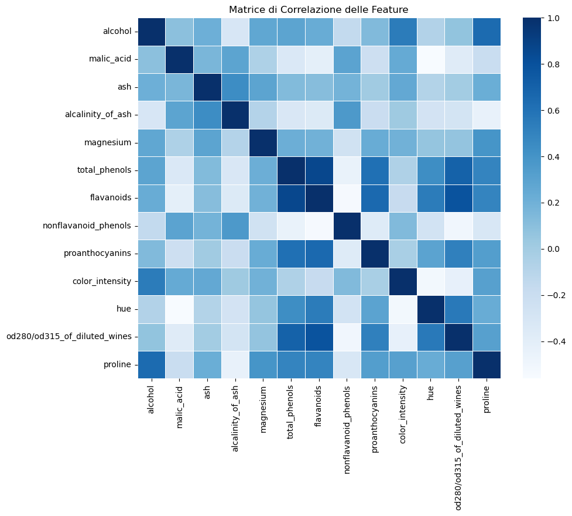
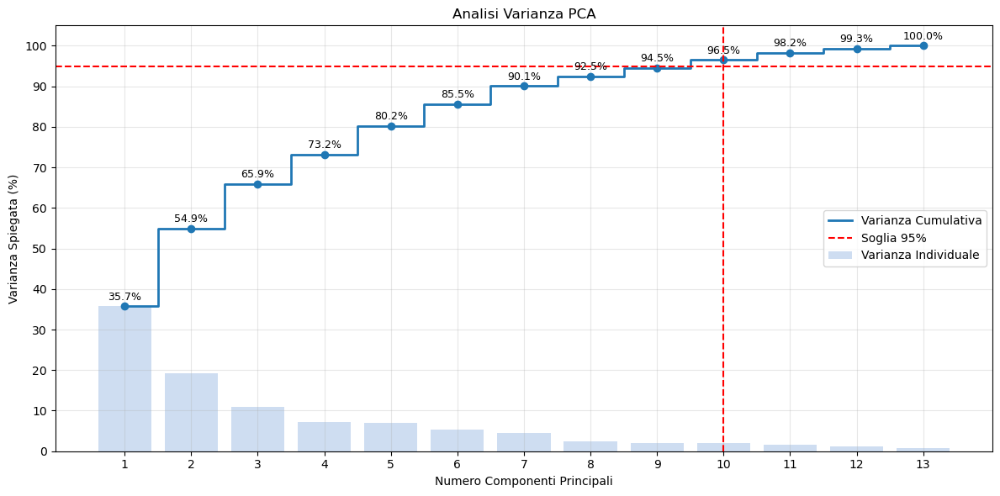
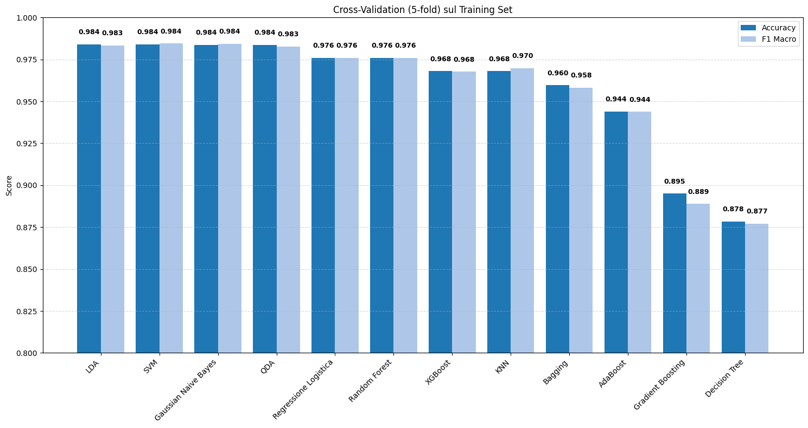
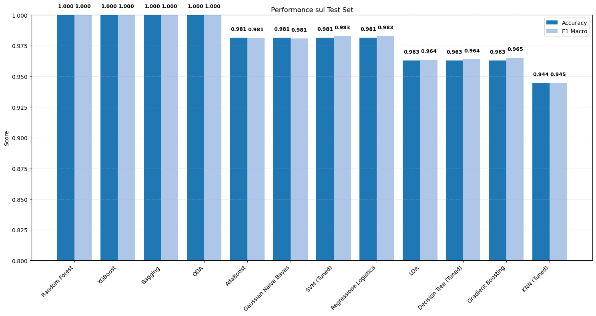

# Wine Classification

My first machine learning project. I compared 12 classification models on the Wine dataset from scikit-learn (178 wines, 13 chemical features, 3 classes).

The dataset is small and easy, so almost every model gets very high scores. The main goal was to practice the full workflow: data exploration, train/test split, cross-validation, hyperparameter tuning and final evaluation.

## Steps

1. **Data exploration**: dataset size, class distribution and correlation between features.
2. **Train/test split**: 70% training, 30% test (stratified). I used PCA to find how many components explain 95% of the variance.
3. **First comparison**: 5-fold cross-validation on the training set, using accuracy and F1 macro.
4. **Tuning**: GridSearchCV on Decision Tree (`ccp_alpha`), KNN (`k`) and SVM (`kernel`, `C`, `gamma`).
5. **Final evaluation**: all models trained on the training set and tested on the test set.

## Models

- **With scaling + PCA**: Logistic Regression, LDA, QDA, Gaussian Naive Bayes, KNN, SVM
- **Without preprocessing**: Decision Tree, Bagging, Random Forest, AdaBoost, Gradient Boosting, XGBoost

Tree-based models don't need scaling or PCA, so I used them on the original features. Scaling and PCA are inside a Pipeline, so they are fitted only on the training data.

## Results



Some features are strongly correlated (for example `total_phenols` and `flavanoids`), which is why I used PCA for the linear and distance-based models.



10 components explain 96.5% of the variance.

### Cross-validation



LDA, SVM, Naive Bayes and QDA got the best results (about 0.984). The Decision Tree was the worst (about 0.878).

### Tuning

| Model | Best parameters | CV accuracy |
|---|---|---|
| Decision Tree | `ccp_alpha = 0.01382` | 0.895 |
| KNN | `k = 13` | 0.976 |
| SVM | `rbf`, `C = 10`, `gamma = 0.01` | 0.992 |

### Test set



| Model | Accuracy | F1 macro |
|---|---|---|
| Random Forest | 1.000 | 1.000 |
| XGBoost | 1.000 | 1.000 |
| Bagging | 1.000 | 1.000 |
| QDA | 1.000 | 1.000 |
| AdaBoost | 0.981 | 0.981 |
| Gaussian Naive Bayes | 0.981 | 0.981 |
| SVM (tuned) | 0.981 | 0.983 |
| Logistic Regression | 0.981 | 0.983 |
| LDA | 0.963 | 0.964 |
| Decision Tree (tuned) | 0.963 | 0.964 |
| Gradient Boosting | 0.963 | 0.965 |
| KNN (tuned) | 0.944 | 0.945 |

The test set has only 54 samples, so one error changes accuracy by about 0.02. The differences between the top models are just one or two errors, so I don't consider them a real ranking.

## How to run

```
pip install -r requirements.txt
jupyter notebook wine_classification.ipynb
```

The comments and plot labels in the notebook are in Italian.
